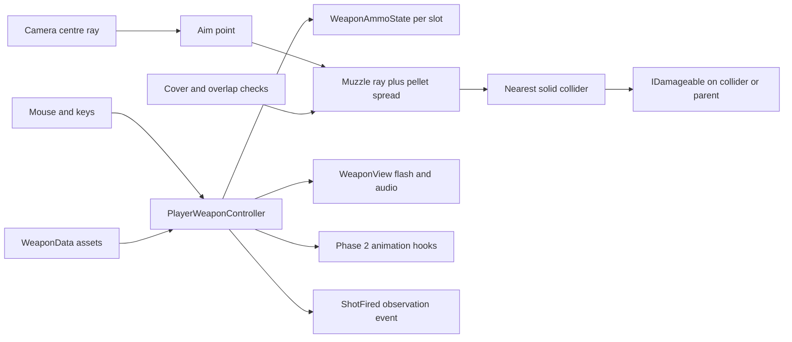

# Zombie Outbreak — Phase 3

This phase adds a modular, hitscan third-person shooting system: Rifle, SMG, Shotgun and Pistol. It keeps the Phase 2 movement, Humanoid Animator and camera. There are no zombies, waves, inventory screen or combat AI.

## Open and run

1. Open **D:/GV project** with **Unity 6000.5.3f1**.
2. Open [ZombieMap](<D:/GV project/Assets/Scenes/ZombieMap.unity>) and press Play.
3. Hold **right mouse** to aim; use **left mouse** to fire. Aim at the centre of the Game view. A crosshair/HUD is not added in this phase.
4. Press **R** to reload, **1/2/3/4** for Rifle/SMG/Shotgun/Pistol, or use the mouse wheel.
5. Release left mouse after switching, then press it again. Hold it for automatic weapons; click once per shot for semi-auto weapons.
6. Existing controls remain: WASD, Shift run, Ctrl sprint, Space jump, mouse look, Escape release cursor, left click to recapture. The recapture click does not fire.

The scene and native assets have been generated with Unity. This is a Unity project, not a packaged Windows executable. Use Unity's Build Profiles when you want an executable; install the matching platform Build Support module if it is absent.

**Verified in Unity 6000.5.3f1:** C# compilation, native scene/asset generation, Phase 2 and Phase 3 structure validation, ammo/physics regression checks and Play Mode weapon integration all passed. A rendered greybox frame was inspected. The keyboard/mouse and visual/audio feel checklist below still needs a manual play pass.

To regenerate missing content, run **Tools > Zombie Outbreak > Phase 3 > Set Up ZombieMap** outside Play Mode. It preserves existing weapon assets, prefabs, loadout tuning and practice targets. If the earlier scene is absent, it invokes the existing Phase 2/Phase 1 builders first. Do not run the Phase 1 rebuild command over a customized scene.

## Packages and project settings

The following built-in packages are enabled at version **1.0.0** through Unity Package Manager:

- `com.unity.modules.animation`
- `com.unity.modules.audio`
- `com.unity.modules.physics`
- `com.unity.modules.particlesystem`

Legacy `UnityEngine.Input` is used, matching Phases 1–2; it does not have a separate `com.unity.modules.inputlegacy` package. Set **Active Input Handling = Input Manager (Old)** or **Both**. Keep Mouse X, Mouse Y and Mouse ScrollWheel axes. The generated project settings include them.

Cinemachine, Input System and Animation Rigging are not required. The existing Phase 2 custom camera already provides shoulder aim blending and collision. The particle module supports the optional ParticleSystem flash hook; the default flash is a small emissive greybox mesh.

Use **Visible Meta Files** and **Force Text**. Commit `Assets`, `Packages`, `ProjectSettings`, guides and all accompanying `.meta` files. Do not commit `Library`, `Temp`, `Logs`, `UserSettings` or build output.

## Complete code and file responsibilities

[PHASE3_SOURCE.md](<D:/GV project/PHASE3_SOURCE.md>) contains complete C# source, with absolute file paths, for every project script at delivery. The actual `.cs` files are authoritative; edit those, not the code snapshot. Do not paste a second copy of a class into the project.

| Full file path | Purpose and GameObject setup |
|---|---|
| `D:/GV project/Assets/Scripts/Core/IDamageable.cs` | Damage contract, `void TakeDamage(float amount)`. No component or Inspector. |
| `D:/GV project/Assets/Scripts/Weapons/WeaponCategory.cs` | Stable None/Rifle/SMG/Shotgun/Pistol identifiers for observation. No component. |
| `D:/GV project/Assets/Scripts/Weapons/WeaponData.cs` | Shared ScriptableObject tuning. Create with Assets > Create > Zombie Outbreak > Weapon Data. Never attach to a GameObject. |
| `D:/GV project/Assets/Scripts/Weapons/WeaponAmmoState.cs` | Plain C# per-slot magazine, reserve, cooldown and reload state. Constructed by the shooter; no Inspector. |
| `D:/GV project/Assets/Scripts/Weapons/WeaponShotInfo.cs` | Immutable shot/noise event payload. No component or Inspector. |
| `D:/GV project/Assets/Scripts/Weapons/WeaponHitscan.cs` | Reusable physics queries and cone spread. Constructed by the shooter; no component. |
| `D:/GV project/Assets/Scripts/Weapons/WeaponView.cs` | Attach to each weapon prefab root. Owns Muzzle, flash and separate shot/reload AudioSources. No damage or ammo logic. |
| `D:/GV project/Assets/Scripts/Weapons/PlayerWeaponController.cs` | Attach once to Player. Owns fixed loadout, input, reload, firing, view instances, hit dispatch and observation events. |
| `D:/GV project/Assets/Scripts/Environment/ShootingTarget.cs` | Attach to each practice target with a solid collider. Receives damage, changes colour and resets after depletion. No AI. |
| `D:/GV project/Assets/Scripts/Player/PlayerHealth.cs` | Existing Player component now implements IDamageable with its existing TakeDamage API. |
| `D:/GV project/Assets/Scripts/Player/ThirdPersonCameraController.cs` | Existing Main Camera component gains ApplyRecoil and CursorLockFrame. |
| `D:/GV project/Assets/Scripts/Player/PlayerAnimatorDriver.cs` | Existing Player component gains CancelWeaponAction for reload completion, switching, disabling and death. |
| `D:/GV project/Assets/Editor/Phase3/Phase3WeaponAssets.cs` | Editor-only builder for four presets, greybox prefabs, materials and original synthesized placeholder audio. No GameObject. |
| `D:/GV project/Assets/Editor/Phase3/Phase3Setup.cs` | Editor-only scene/prefab wiring and structure validator. No GameObject. |
| `D:/GV project/Assets/Editor/Phase3/Phase3Checks.cs` | Explicit Edit Mode ammo/physics regression checks. Menu or batch entry point; no GameObject. |
| `D:/GV project/Assets/Editor/Phase3/Phase3PlayChecks.cs` | Batch-only Play Mode integration checks. No GameObject; exits the temporary Editor after completion. |
| `D:/GV project/Assets/Editor/ProjectBootstrap/PackageInstaller.cs` | Optional batch-only built-in module installer through PackageManager.Client. No component; modules are already installed. |

Minimal compatibility fixes were also needed in the earlier builders: `D:/GV project/Assets/Editor/Phase2/Phase2HumanoidFactory.cs` now uses valid `AnimationClipSettings.loopBlendOrientation/PositionY/PositionXZ` fields, and `D:/GV project/Assets/Editor/Phase1SceneBuilder.cs` uses `VersionControlSettings.mode`. These fix actual compiler errors/warnings discovered when opening this project in Unity.

## Architecture and aiming



Each player gets its own ammo objects. Shared WeaponData assets are read during gameplay and are never decremented. Reserve ammo is per weapon slot, not pooled by category. Switching reuses the same state and cached view, preserving magazine, reserve and cooldown. No pickup system or inventory UI is involved.

The firing sequence is:

1. Phase 2 reads aim intent and turns the body toward camera yaw. In aim mode movement remains camera-relative strafing, with no sprint.
2. In LateUpdate, after animation and camera updates, raycast from viewport `(0.5, 0.5)` to the first solid hit or the weapon's range.
3. Rotate the weapon around its grip so its barrel points toward that aim point. The weapon stays parented to the animated right hand.
4. Check the muzzle and the upper-body shot origin for overlap, and raycast from that origin to the muzzle. This blocks a barrel sticking through a thin wall.
5. If the camera origin is inside cover, or the aim point is behind the muzzle, mark the shot blocked. A blocked discharge still spends one round and creates flash/sound/noise, but deals no damage beyond the obstruction.
6. For each pellet, cast from the muzzle toward the selected point plus random cone spread. Only this muzzle ray deals damage; the camera ray never does.
7. Apply damage to the nearest collider's `IDamageable` parent. Solid scenery stops the ray even without an IDamageable. Ignore trigger volumes and the entire shooter's transform hierarchy.
8. Spend one round per discharge, emit one noise event, play flash/audio/Fire animation, apply camera kick and add spread bloom.

Range is measured from the muzzle for damage. The camera's selection ray is also capped at the weapon range; targets beyond effective muzzle range receive no hit. Shotgun damage is **per pellet**, with no penetration, falloff, projectile travel, headshot multiplier or automatic reload.

Physics query buffers fall back to full queries when saturated, then explicitly select the closest external hit. Unity raycasts do not detect a collider containing their origin, which is why overlap checks are necessary. [Unity Physics.Raycast documentation](https://docs.unity.com/en-us/engine/6000.0/script-reference/unityengine/physics/raycast).

## ScriptableObject setup and values

The generated assets are:

- [Rifle.asset](<D:/GV project/Assets/Data/Weapons/Rifle.asset>)
- [SMG.asset](<D:/GV project/Assets/Data/Weapons/SMG.asset>)
- [Shotgun.asset](<D:/GV project/Assets/Data/Weapons/Shotgun.asset>)
- [Pistol.asset](<D:/GV project/Assets/Data/Weapons/Pistol.asset>)

| Setting | Rifle | SMG | Shotgun | Pistol |
|---|---:|---:|---:|---:|
| Damage per pellet | 25 | 12 | 10 | 25 |
| Fire rate, shots/second | 8 | 12 | 1.1 | 4 |
| Magazine | 30 | 35 | 8 | 12 |
| Starting reserve | 120 | 140 | 32 | 60 |
| Reload seconds | 2.2 | 1.8 | 2.8 | 1.45 |
| Range, metres | 100 | 65 | 35 | 70 |
| Automatic | Yes | Yes | No | No |
| Spread half-angle, degrees | 0.6 | 1.1 | 4.5 | 0.45 |
| Pellets per spent round | 1 | 1 | 8 | 1 |
| Upward recoil, degrees | 0.65 | 0.4 | 2.2 | 1.1 |
| Random yaw recoil, ±degrees | 0.195 | 0.12 | 0.66 | 0.33 |
| AI noise radius, metres | 35 | 28 | 45 | 22 |

Shared defaults: Audio Volume **0.35**, Spread Per Shot **0.25°**, Maximum Extra Spread **2°**, Spread Recovery **3°/second**. Starting reserve is additional to a full initial magazine. Recoil changes camera orbit; compensate with mouse movement. Spread bloom recovers automatically on equipped and unequipped slots.

Each asset references its WeaponView prefab, generated fire AudioClip and ReloadClick clip. Muzzle Flash Prefab is optional. To use particles, assign a prefab with a ParticleSystem: Play On Awake off, Looping off, one short burst, duration around 0.05–0.1 seconds. A WeaponData particle prefab overrides the view's local particle hook. Without either, the greybox mesh flash is used.

All four weapons use magazine reloads. The shotgun is intentionally magazine-fed in this phase: it consumes one shell for eight pellets and reloads the magazine in one timed operation. Rate means **shots per second**, not RPM; divide RPM by 60 when configuring it.

ScriptableObjects keep shared data independent of individual component instances; live mutable ammo stays in WeaponAmmoState. [Unity ScriptableObject manual](https://docs.unity3d.com/6000.1/Documentation/Manual/class-ScriptableObject.html).

## Weapon prefab setup

Full prefab paths:

- `D:/GV project/Assets/Prefabs/Weapons/Rifle.prefab`
- `D:/GV project/Assets/Prefabs/Weapons/SMG.prefab`
- `D:/GV project/Assets/Prefabs/Weapons/Shotgun.prefab`
- `D:/GV project/Assets/Prefabs/Weapons/Pistol.prefab`

The builder creates a visibly different barrel/body length for each weapon. All models are original greybox cubes. Each prefab follows this convention:

```text
Rifle [WeaponView, AudioSource (shots), AudioSource (reload)]
├── Receiver
├── Barrel
├── Grip
├── Stock                   # absent on Pistol
├── Magazine                # absent on Pistol
└── Muzzle
    └── Greybox Flash       # starts inactive
```

Place the prefab root at the right-hand grip point: local position `(0,0,0)`, rotation `(0,0,0)`, scale `(1,1,1)`. The barrel must point along root **+Z**, with **+Y** up. Put Muzzle just beyond the barrel tip; it must be a child of the root. Align imported meshes beneath the root, rather than changing this coordinate convention.

WeaponView Inspector:

| Field | Assignment/value |
|---|---|
| Muzzle | Prefab's Muzzle child |
| Muzzle Flash | Optional local ParticleSystem, otherwise None |
| Greybox Flash | Inactive emissive flash child |
| Shot Audio | First AudioSource |
| Reload Audio | Separate second AudioSource so reload cancellation cannot cut off another shot source |
| AudioSource settings | Play On Awake off; Spatial Blend 1; Doppler 0; Min Distance 2; Max Distance 45 |

Remove every Collider/Rigidbody from held weapon prefabs. They are presentation objects and should not collide with the player, block rays or alter movement. Generated weapon parts are on Ignore Raycast layer. Player exclusion is also enforced in code, so adding a player child collider does not make the player shoot themselves.

A weapon view is instantiated once per slot at runtime, under the socket. Exactly the selected view is active. Do not manually place another rifle in the scene socket or you will see a duplicate.

## Player hierarchy and Inspector

```text
ZombieMap
├── Environment [existing floor, cover and boundaries]
├── Player
│   [CharacterController, ThirdPersonPlayerController, PlayerHealth]
│   [PlayerAimController, PlayerAnimatorDriver, PlayerWeaponController]
│   ├── Humanoid_Greybox (inactive legacy visual, if present)
│   ├── Humanoid_Phase2 [Humanoid Animator]
│   │   └── Hips / Spine / Chest / RightShoulder / RightUpperArm
│   │       └── RightLowerArm / RightHand
│   │           └── WeaponSocket
│   │               ├── Rifle   (runtime, active initially)
│   │               ├── SMG     (runtime, inactive initially)
│   │               ├── Shotgun (runtime, inactive initially)
│   │               └── Pistol  (runtime, inactive initially)
│   ├── CameraTarget
│   │   └── AimTarget
│   └── GroundCheck
├── Main Camera [Camera, AudioListener, ThirdPersonCameraController]
│   └── Camera Modes
│       ├── Exploration Camera [ThirdPersonCameraMode]
│       └── Aim Camera [ThirdPersonCameraMode]
├── Phase3 Practice Range
│   ├── Target 1 (200 HP) [BoxCollider, ShootingTarget]
│   ├── Target 2 (200 HP)
│   ├── Target 3 (200 HP)
│   └── Target 4 (200 HP)
└── Directional Light
```

The saved player prefab is [PlayerPhase3.prefab](<D:/GV project/Assets/Prefabs/Player/PlayerPhase3.prefab>). Scene-only camera references are removed while saving it and restored on the scene instance. At runtime, a prefab instance resolves Camera.main if not explicitly assigned. Keep one MainCamera and one AudioListener.

PlayerWeaponController Inspector:

| Field | Assignment/value |
|---|---|
| View Camera | Main Camera's Camera |
| Camera Rig | Main Camera's ThirdPersonCameraController |
| Aim | Player's PlayerAimController |
| Health | Player's PlayerHealth |
| Animation Driver | Player's PlayerAnimatorDriver |
| Weapon Socket | Animator's RightHand/WeaponSocket |
| Shot Origin | CameraTarget (inside upper body at local Y≈1.48) |
| Aim Target | CameraTarget/AimTarget |
| Loadout | Rifle, SMG, Shotgun, Pistol assets, in that order |
| Starting Weapon | 0 |
| Hit Layers | Default Raycast Layers; include all solid environment and damage targets |
| Muzzle Clearance | 0.025 metres |
| Firing Activity Seconds | 0.2 |
| Draw Shot Rays | On for Scene-view inspection; can disable for delivery |

Shot Origin must stay within the character body, never at the camera. Hit Layers must include cover as well as targets. Excluding cover deliberately permits shots through it. Default player/weapon Ignore Raycast layer is excluded, and code also ignores the entire owner hierarchy. Trigger-only hurtboxes are intentionally ignored in this phase: use solid colliders.

ShootingTarget Inspector: Max Health **200**, Reset Delay **3 seconds**, Target Renderer optional (auto-resolved), Log Hits **on**. Targets remain solid after depletion and reset health/colour after the delay. Orange means hit, red means depleted. No enemy behavior is involved. Use a separate receiver component implementing IDamageable for future breakables or enemies.

## Animation and camera integration

Keep the Phase 2 Animator Controller and its blend trees. Its existing Fire and Reload triggers now have gameplay callers. `PlayerWeaponController` calls PlayFire once per spent round, PlayReload once on reload start, and CancelWeaponAction when a reload completes or is cancelled. PlayerHealth still drives the existing Death hook.

The **reload timer in WeaponAmmoState is authoritative**. The earlier generic reload clip is a visual placeholder and can finish before some weapon reload timers. It never grants ammo through Animation Events. For production animation, replace it with weapon-specific clips or drive a ReloadSpeed parameter based on clip duration / WeaponData.ReloadTime. Rapid automatic shots can outpace a single generic Fire clip; the shot effects, cooldown and damage still run per discharge.

Execution order: camera **-200**, aim **-100**, movement **0**, animator driver **100**, shooter **200**. The shooter casts in LateUpdate, after the camera's LateUpdate and animated hand pose. Recoil is applied to camera yaw/pitch after the shot and becomes visible on the next camera update. Body yaw continues to follow the camera through the Phase 2 movement script.

The gun stays attached to RightHand, but aiming rotates the weapon view around its grip. This is a greybox compromise: the off-hand is not locked to the foregrip and wrist alignment needs later rigging. A future Unity Animation Rigging pass can use two-bone IK for the left hand and an upper-body aim constraint. Do not let both Animator root motion and CharacterController drive player movement.

## Future AI and UI hooks

Read these from the Player's `PlayerWeaponController` without knowing input bindings:

| API | Meaning |
|---|---|
| CurrentWeapon | Equipped shared WeaponData, or null before initialization |
| CurrentWeaponCategory | Rifle/SMG/Shotgun/Pistol, or None |
| MagazineAmmo / ReserveAmmo | Live ammo values for equipped slot |
| IsReloading | Current slot reload in progress |
| IsFiring | A successful discharge happened within the last 0.2 scaled seconds, while alive and enabled |
| LastShotTime / LastShotPosition | Last successful discharge; initial time is negative infinity |
| CurrentAimPoint | Latest camera selection point |
| LastShotBlocked | Last discharge was blocked by origin/barrel/near-camera geometry |
| WeaponChanged | Equipped WeaponData changed |
| AmmoChanged | Live magazine and reserve values changed |
| ReloadStateChanged | Reload started or ended/cancelled |
| ShotFired | One WeaponShotInfo per discharge, including a shotgun blast |
| HitDetected | One RaycastHit and damage value per pellet collision; scenery hits also report |

WeaponShotInfo contains Source, Weapon, Category, Position, NoiseRadius and Time. Noise radius is a gameplay tuning value, independent of audible falloff. The future hearing system can compare its listener's position with Position, then decide whether walls occlude noise. No hearing scan, Runner/Elite decisions, AI state machine or global event bus is implemented now.

Subscribe in a future component's OnEnable and unsubscribe in OnDisable. Read initial properties as well: a WeaponChanged event emitted during Awake can precede subscriptions. IsFiring means recent successful shots, not a held trigger or continuous sound; slow weapons may report false between shots. Observe ShotFired when every discharge matters.

Public SelectWeapon, TryReload and TryFire allow a future input adapter to reuse the system. TryFire attempts one round and enforces alive/aim/pause/ammo/reload/cooldown gates. The current Update loop provides automatic-hold versus semi-auto-edge behavior; programmatic callers choose when to invoke TryFire. Call it after camera updates for current-frame convergence.

## Testing procedure

### Automated checks

Run **Tools > Zombie Outbreak > Phase 3 > Validate Active Scene** and **Run Ammo and Physics Checks** outside Play Mode. The latter creates an additive scratch scene, performs checks, then closes it without changing ZombieMap.

Batch asset/physics check, with no other Editor using this project:

```powershell
unity run 'D:\GV project' --editor-version 6000.5.3f1 --timeout 240 -- -nographics -executeMethod Phase3Checks.BuildAndCheck -logFile 'D:\GV project\Logs\Phase3BuildAndCheck.log'
```

Batch Play Mode integration check (the method exits its Editor itself; omit `-quit`):

```powershell
Start-Process -FilePath 'D:\unity\6000.5.3f1\Editor\Unity.exe' -ArgumentList '-batchmode -projectPath "D:\GV project" -executeMethod Phase3PlayChecks.RunBatch -logFile "D:\GV project\Logs\Phase3PlayChecks.log"' -WindowStyle Hidden -Wait
```

Look for `PHASE3_CHECKS_PASS` and `PHASE3_PLAY_CHECKS_PASS`, respectively. The Play check uses the generated preset values, creates a temporary runtime target and never saves its changes. If you intentionally tune weapon damage/capacities, update the integration expectations accordingly. No NUnit/Test Framework package is required.

### Manual play checklist

| Action | Expected result |
|---|---|
| Enter Play | Exactly one visible Rifle on right hand; no errors. |
| RMB + move WASD | Body follows camera yaw; strafe/backpedal without turning away. |
| Hold LMB with Rifle/SMG | Repeated shots until empty; no faster than the configured rate. |
| Hold LMB with Pistol/Shotgun | One shot per press, with cooldown between accepted presses. |
| Fire at a target | Console health changes, target turns orange then red and resets after 3 seconds. |
| Close shotgun shot | Up to 8 hits of 10 damage; exactly one shell, one sound/noise event. |
| Stand beside cover, camera sees target but barrel does not | Target receives no damage through cover. Inspect yellow/red Scene-view rays. |
| Push barrel into or through a thin wall | Blocked discharge; no damage on far side. |
| Aim very close to a wall or turn camera into cover | No backward shot through the player; blocked flag can be inspected. |
| Fire, R, wait | Missing magazine rounds move from reserve after reload time. |
| R on full magazine or zero reserve | No reload starts. |
| Start reload, switch away and back before completion | No free refill; magazine and reserve unchanged. |
| Switch repeatedly after firing | Per-weapon cooldowns persist; no rapid-fire exploit. Release trigger after switch. |
| Exhaust reserve | Final partial reload transfers only remaining reserve; no negative ammo. |
| Escape / lose focus / pause | No mouse-input firing; pause freezes cooldown/reload progression. A reload may finish while cursor is unlocked if time keeps running. |
| PlayerHealth.Die or Animator Preview Death | Reload cancels, held weapon hides, firing/switching/reload stop. |
| Two player instances sharing a WeaponData asset | Each has separate ammo; editing runtime ammo never changes the asset. |
| Observe flash/audio/recoil | Muzzle flashes at barrel tip; sound on discharge; camera kicks; sustained fire broadens spread. |

For ammo inspection during Play Mode, select Player and use the PlayerWeaponController component's context menu **Phase 3 > Log Current Weapon and Ammo**. There is no ammo HUD. Clear Console Collapse if counting target hit messages. Enable Game/Scene Gizmos to view Debug.DrawLine traces. Visual/audio feel and physical keyboard/mouse behavior require a manual play pass even after automated checks.

## Common third-person shooting bugs and fixes

| Symptom | Cause and fix |
|---|---|
| Camera sees target but bullets pass through cover | Only camera ray was used, or cover layer excluded. Keep the muzzle ray plus body-to-muzzle guard and include environment in Hit Layers. |
| Muzzle embedded in wall still fires through | A ray started inside the collider. Keep overlap checks and a nonzero Muzzle Clearance. |
| Bullets hit the player/gun | Remove weapon colliders; keep owner hierarchy exclusion. Do not put another player's target colliders under this shooter's root. |
| Hits go sideways | Model/root axis mismatch. Align visible meshes under a grip-origin root with barrel +Z; verify Muzzle placement. |
| Gun floats/doubles | Use the Animator's mapped RightHand/WeaponSocket and remove manually placed duplicate views. Runtime creates the four views. |
| Gun aim lags mouse by a frame | Read current camera pose in LateUpdate after camera order -200; keep shooter order 200. |
| Character turns away while aiming | PlayerAimController or movement aim reference missing. Run setup/validation; Phase 2 owns body rotation. |
| Backward shots at close cover | Camera aim point is behind muzzle. The shooter blocks that discharge; do not remove the dot-product check. |
| Every player shares ammo | Runtime values were stored on WeaponData. Keep them only in WeaponAmmoState. |
| Reload grants ammo twice | Remove ammo-granting animation events/coroutines. TickReload is the only transfer point. |
| Reload visual ends early | Generic Phase 2 clip is shorter than weapon reload time. Retune/replace animation; gameplay timer still blocks fire correctly. |
| Automatic fire bursts after a stall | Avoid unlimited catch-up loops. This implementation emits at most one discharge per frame and schedules from actual shot time. At low FPS this reduces effective fire rate. |
| Holding semi-auto fires repeatedly | Use GetMouseButtonDown, not held input, for semi-auto weapons. |
| Freshly switched gun does not immediately fire while LMB held | Intentional trigger safety: release and press LMB after switching or focus loss. |
| Empty gun makes no noise | Empty clicks/dry-fire sounds are outside this phase. Press R if reserve is available. |
| No sound | Check AudioListener, muted Game audio, FireAudio assignment, separate AudioSources and Audio module. Hooks accept replacement audio clips. |
| No damage | Target needs a solid collider on an included layer and IDamageable on it or a parent. Triggers are ignored. |
| Pink meshes | Use Standard materials for Built-in or URP/Lit for URP. The builder chooses based on the current pipeline when creating materials. |
| Missing Physics/Animator/ParticleSystem types | Enable the four built-in modules listed above; do not install unrelated systems. |
| Cannot attach scripts / duplicate class errors | Keep one copy at the documented path. Keep all Editor code under Assets/Editor. |

## Phase 3 checklist

- [x] One reusable shooter for four weapon categories.
- [x] Shared WeaponData assets and per-owner mutable ammo state.
- [x] Camera-to-aim-point selection and separate muzzle hit detection.
- [x] Near-cover overlap/obstruction checks and owner exclusion.
- [x] Automatic/semi-auto input, cooldown, reload, reserve and weapon switching.
- [x] Shotgun pellets consume one shell; nearest-hit damage through IDamageable.
- [x] Visible greybox weapons under RightHand/WeaponSocket at runtime.
- [x] Muzzle flash, audio hooks, placeholder sounds, camera recoil and spread bloom.
- [x] Fire/Reload animation hooks connected; cancellation/death stop weapon actions.
- [x] Current weapon/category, firing activity and noise observation API.
- [x] Practice targets, scene/prefab setup tool and regression checks.
- [x] Full source snapshot, Inspector setup, testing procedure and bug guide.
- [ ] Complete the manual visual/audio/input checklist on your machine.
- [ ] Make and commit a standalone build only when the assignment requires it.

## Suggested Git commit messages

1. `fix: enable required Unity modules and correct animation builder APIs`
2. `feat: add shared weapon data and per-player ammo state`
3. `feat: implement camera-to-muzzle hitscan firing and reload switching`
4. `feat: add greybox weapon prefabs effects and damage targets`
5. `feat: expose weapon category and firing noise observations`
6. `test: cover weapon ammo physics and play mode integration`
7. `docs: document Phase 3 setup controls and troubleshooting`

The repository currently has no commits. For a first commit, include the existing Phase 1–2 foundation as well. Commit generated `.unity`, `.prefab`, `.asset`, `.anim`, `.mat`, `.wav` and matching `.meta` files together. Source collaborators can then open the already-generated scene; they do not have to regenerate GUIDs or build assets independently.

Stop here. Phase 4, zombies, waves and inventory UI are not included.
